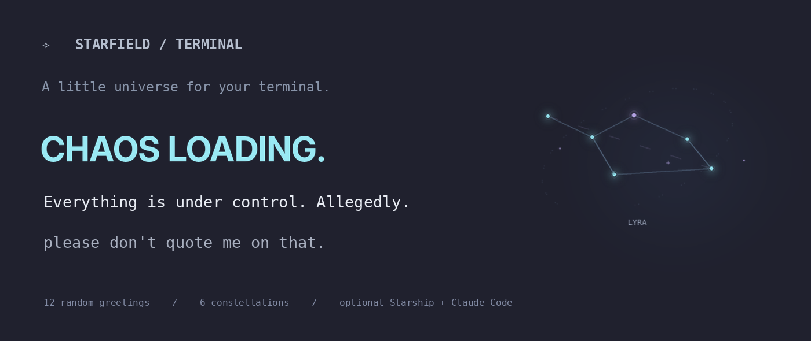

# ✧ Starfield Terminal · 星图终端

**给终端一片自己的小宇宙。**

每开一个新的终端标签页，在你的提示符上方随机出现一张星图插画和一句英文冷幽默。可选 Claude Code 双行状态栏；可选 Starship 提示符预设 —— 由你自己挑，程序绝不替你改。

[English README](README.md) · [Starship 预设](docs/STARSHIP.md) · [兼容性](#兼容性) · [遇到问题](#遇到问题)

[](https://github.com/yimleunggggg/starfield-terminal/actions/workflows/tests.yml)
[](LICENSE)



---

## 会看到什么

每次打开交互式终端，随机抽取**一条**欢迎语（共 12 组），配**一张**星图（共 6 款）。文案和插画是分开随机抽的，所以组合很难重复。

- **12 组欢迎语**：标题、正文、斜体收尾，各带一个 emoji。
- **6 款星图插画**：星点、连线、星座名，在 Ghostty 上通过 Kitty 图形协议以真实 PNG 显示。
- **12 张加粗标题图**：Ghostty 宽窗口下显示大号标题，窄窗口和其他终端自动退回文字。
- **可选 Claude Code 双行状态栏**：项目、Git 分支、模型、上下文占用。同一会话内 emoji 固定。
- **可选趣味加载状态**：Claude Code 内置的每个加载动词都配一个 emoji，另加几个彩蛋词。词库从你实际安装的 Claude Code 里读取。
- **可选 Starship 预设选择器**：在 4 款**官方**预设里挑一个，写入前先备份你现有的 `starship.toml`。不选就不动。

**安装器只会写入：** `~/.config/starfield-terminal/` 下自己的文件、shell 启动文件里一个带标记的代码块，以及仅在 `--with-claude` 时修改 `~/.claude/settings.json` 的 `statusLine` 键、仅在 `--with-spinner` 时修改同一文件的 `spinnerVerbs` 键。不碰你的项目目录、不装字体、不改 Ghostty 配置。独立的 Starship 选择器还会写 `~/.config/starship.toml`，但只在你主动运行时，且写入前一定先备份。

---

## 环境要求

| | |
| --- | --- |
| Python | 3.8 或更高（`python3 -V`） |
| 终端 | 想看图需要 [Ghostty](https://ghostty.org/download)；纯文字任何终端都行 |
| Shell | macOS / Linux 用 zsh 或 bash，Windows 用 PowerShell |

不需要 pip 安装任何包，不联网，不附带字体。

---

## 四件独立的东西

同一个安装器、同一个配置目录，但你可以只取其中一部分。

| 东西 | 怎么开 | 需要什么 | 会写什么 |
| --- | --- | --- | --- |
| **欢迎画面** | `bash scripts/install.sh` | Python 3.8+；看图需要 Ghostty | `~/.config/starfield-terminal/`，以及 `~/.zshrc` 或 `~/.bashrc` 里一个带标记的代码块 |
| **Claude Code 状态栏** | `bash scripts/install.sh --with-claude` | Python 3.8+（这一步会顺带装好欢迎画面） | 同上，另加 `~/.claude/settings.json` 里的 `statusLine` |
| **趣味加载状态** | `bash scripts/install.sh --with-spinner` | Claude Code CLI；Python 3.8+（这一步会顺带装好欢迎画面） | 同上，另加 `~/.claude/settings.json` 里的 `spinnerVerbs`，写入前先做带时间戳的备份 |
| **Starship 预设** | `bash scripts/starship-presets.sh` | Starship 已由你自行安装并初始化 | `~/.config/starship.toml`，写入前先做带时间戳的备份 |

前三件是安装器的开关；第四件是独立脚本，只有你主动运行时才会动，而且 `starship` 不在 `PATH` 里它会直接退出并提示去看官方安装指南。

---

## 快速开始

```bash
git clone https://github.com/yimleunggggg/starfield-terminal.git
cd starfield-terminal
bash scripts/install.sh
```

然后**新开一个** Ghostty 标签页，就装好了。

第一次在终端里安装时，脚本只会问一个问题 —— 状态栏上怎么称呼这台机器：

```
Name for the statusline [你的-MacBook-Pro]:
```

直接回车就沿用电脑名称，也可以随便输入你喜欢的名字（比如 `NOVA / LAB`、`工作室`）。不想被问，装的时候加 `--name="NOVA / LAB"` 跳过。

想用 ZIP 也可以：点绿色的 **Code** 按钮下载，解压后进入文件夹运行同一条命令。

如果还想要 Claude Code 状态栏，这是**另一步**，需要单独选择：

```bash
bash scripts/install.sh --with-claude
```

如果状态栏没变，重启 Claude Code。

还想让 Claude Code 的等待动词带上 emoji？同一个安装器，另一个开关：

```bash
bash scripts/install.sh --with-spinner
```

### 不开标签页也能看效果

```bash
python3 ~/.config/starfield-terminal/welcome.py              # 随机一条
python3 ~/.config/starfield-terminal/welcome.py --gallery    # 六款星图全看
python3 ~/.config/starfield-terminal/welcome.py --no-image   # 纯文字
python3 ~/.config/starfield-terminal/welcome.py --seed 5     # 固定随机种子
python3 ~/.config/starfield-terminal/welcome.py --diagnose   # 为什么没有图
python3 ~/.config/starfield-terminal/welcome.py --version
```

---

## 改成你自己的

所有东西都在 `~/.config/starfield-terminal/` 下。

**标签文字。** `config.json` 里有两个互不相干的字段：

- `label` —— 每组欢迎语上方那行字，默认 `STARFIELD / TERMINAL`。
- `status_label` —— Claude Code 状态栏上的身份，来自你安装时输入的名字；没输入则用电脑名称。

```json
{
  "label": "NOVA / STUDIO",
  "status_label": "NOVA / LAB"
}
```

删掉 `status_label` 就回到默认的机器名。用任何文本编辑器打开都行 —— `open -e` 只有 macOS 有。

**欢迎语文案。** 把 `examples/welcome-library.json` 复制到 `~/.config/starfield-terminal/welcome-library.json`。每一项是四元数组：`[emoji, 标题, 正文, 收尾]`。每一行都必须是四个字符串 —— **只要有一行格式不对，整个文件会被忽略**，退回内置的 12 组文案。自定义标题以文字显示，不使用标题图片。

**插画。** 把替换文件放进 `~/.config/starfield-terminal/constellations/`（`celestial-01.png` 到 `celestial-06.png`）和 `titles/`（`title-01.png` 到 `title-12.png`）。

---

## Claude Code 状态栏

长这样：

```
🍳  NOVA / LAB  │ PROJECT  starfield-terminal  ·  GIT main
MODEL  Claude Fable 5.1  │  CTX  42%
```

- emoji 由会话 ID 推导，所以一次对话里不会变。
- 当前目录不是 Git 仓库时，`GIT` 段自动隐藏。
- 第三方网关的上下文百分比会带 `~`，因为那类窗口大小往往是估算而非真实上报。
- 窗口变窄时先丢 Git 段，再截断项目名。

随时可以用 `bash scripts/uninstall.sh` 关掉 —— 请在克隆下来的文件夹里运行，脚本就在仓库里。它会还原你之前的 `statusLine`，但只在当前值仍然指向本项目时才还原，不会覆盖你后来的改动。

---

## 趣味加载状态（可选，独立）

Claude Code 等待时会随机显示一个动词：`Baking`、`Cooking`、`Smooshing`、`Razzle-dazzling`……这一项给内置的每个动词配一个 emoji：

```
✳ 🥐 Baking…
```

```bash
bash scripts/install.sh --with-spinner
```

作为安装器开关，这一步也会顺带安装或更新欢迎画面，和 `--with-claude` 的行为一致；只想要 spinner 的话，单独运行 `python3 scripts/claude-spinner.py`。

脚本从你已安装的 Claude Code 里读出动词表（2.1.x 是 187 个），逐个配 emoji，再补几个额外词。只改 `~/.claude/settings.json` 的 `spinnerVerbs`，文件里的其他设置原样保留；改动前会把旧设置备份到 `~/.config/starfield-terminal/backups/`。

安装器会明确告诉你词表从哪来，只会是下面两种之一：

```
Source: 187 native verbs read from Claude Code 2.1.312 (/path/to/claude)
Source: bundled snapshot of 187 verbs; /path/to/claude could not be inspected, so a newer built-in list may be missing
```

第二行表示没能读取你的 Claude Code（少见的安装布局，或某些 Windows shim）。spinner 仍能用，但用的是内置快照，不是你那个版本自己的词表。遇到这种情况，用 `--claude PATH` 指向真实的 `claude.exe`。

**为什么用 `replace` 而不是 `append`。** Claude Code 的 `append` 模式只是把你的词拼到内置词库后面，内置词本身不会带上 emoji；只有 `replace` 能让每个动词都带 emoji，代价是列表变成一份快照。脚本每次运行都会重新读取已安装的二进制，所以 Claude Code 升级后：

```bash
python3 ~/.config/starfield-terminal/claude-spinner.py --check   # 看少了哪些新词
python3 ~/.config/starfield-terminal/claude-spinner.py           # 重新生成
```

用 `python3 ~/.config/starfield-terminal/claude-spinner.py --remove` 或 `bash scripts/uninstall.sh` 撤销；两者都只会还原安装前的 `spinnerVerbs`，如果你之后自己改过就保持不动。`--dry-run` 只打印配置不写入，`--list` 列出本机读到的原生词，`--claude PATH` 用于非标准安装路径。

只要跑的是 Claude Code CLI 就能用：macOS、Linux、Windows、任意终端，不依赖 Ghostty、Starship 或欢迎画面。每台机器单独配置，不会同步。终端字体需要能显示 emoji，否则会看到方块。

---

## Starship（可选，独立项目）

原图上那条彩虹提示符来自 **[Starship](https://starship.rs/)**，是完全独立的第三方项目。本项目**不会**安装 Starship，也不会擅自改动你的提示符。下面这个可选的选择器只会在你主动运行时写入一款预设，且写入前先做带时间戳的备份并征求你确认。如果你本来就在用 Starship，想换个样子：

```bash
bash scripts/starship-presets.sh --list
bash scripts/starship-presets.sh
```

选择器提供 4 款[官方预设](https://starship.rs/presets/)，写入前备份现有的 `~/.config/starship.toml`，并询问确认。输入 `0` 什么都不改；`starship` 不在 `PATH` 里时它会直接退出并提示你去看安装指南。多数 Powerline 预设需要 Nerd Font，本项目不附带字体。

详细说明和非交互用法见 [docs/STARSHIP.md](docs/STARSHIP.md)。

---

## 兼容性

只有 Ghostty 会画图。其他终端也都能用，只是走文字排版。

| 设备 / 终端 | 运行 | 效果 |
| --- | --- | --- |
| macOS + Ghostty（zsh） | `bash scripts/install.sh` | 欢迎语、星图、可选状态栏 |
| macOS Terminal.app / iTerm2 | `bash scripts/install.sh --all-terminals` | 文字版欢迎语、可选状态栏 |
| Linux + Ghostty + bash | `bash scripts/install.sh --shell=bash` | 欢迎语、星图 |
| Linux 其他终端 | `bash scripts/install.sh --all-terminals` | 文字版欢迎语 |
| VS Code / JetBrains 内置终端（macOS、Linux） | `bash scripts/install.sh --all-terminals` | 文字版欢迎语 |
| Windows Terminal + PowerShell | `.\scripts\install-windows.ps1` | 文字版欢迎语，无状态栏 |
| 通过 SSH 登录的远程机器 | 不会触发，见下 | — |

四个要点：

- **每台机器各装一次。** 没有任何同步。`config.json`、你取的名字、自定义素材都只留在安装时那台机器上，换设备要重跑一次。
- **所有模式都会跳过 SSH 会话。** Ghostty 模式和 `--all-terminals` 都检查 `SSH_CONNECTION`，所以登录服务器永远不会弹出欢迎语。真想要就在那边手动运行 `python3 ~/.config/starfield-terminal/welcome.py`。
- **出图要两个条件同时满足**：Ghostty，且窗口宽度 ≥ 84 列。星图用的是 Kitty 图形协议，Terminal.app 和 Windows Terminal 都没有实现。
- **tmux / screen 尚未测试。** 文字会正常打印；如果图没了，多半是复用器吞掉了图形转义序列。

---

## 遇到问题

**新开标签页什么都没有，或者有文字没有图。**
先跑 `python3 ~/.config/starfield-terminal/welcome.py --diagnose`，它会打印识别到的终端、列数，以及是哪一项没通过。常见原因：默认安装只在 Ghostty 的交互式、非 SSH 会话里触发（其他终端加 `--all-terminals`），以及出图还需要窗口至少 84 列。

**Claude Code 还是旧状态栏。**
重启 Claude Code。确认 `~/.claude/settings.json` 里的 `statusLine` 指向 `starfield-terminal/statusline.py`。

**emoji 或框线字符错位。**
这是字体问题，不是渲染问题 —— 在终端设置里换一款等宽字体即可。

**每个标签页出现两份欢迎语。**
你的 shell 启动文件里还有别的欢迎脚本。搜 `STARFIELD TERMINAL` 标记块，把周围其他的欢迎调用删掉。

**更新到新版本。**
进到克隆下来的文件夹 `git pull`，然后 `bash scripts/install.sh`；如果用状态栏就加 `--with-claude`，如果用趣味加载状态就加 `--with-spinner`，这两个脚本分别由对应的开关复制。你的 `config.json` 和自定义的 `welcome-library.json` 都会保留。

**想重来。**
`bash scripts/uninstall.sh`（在克隆下来的文件夹里运行）会移除启动块并还原状态栏。资源文件和备份会保留在 `~/.config/starfield-terminal/`，方便你回滚。

---

## Windows

```powershell
powershell -ExecutionPolicy Bypass -File .\scripts\install-windows.ps1
```

只有文字欢迎语，不装星图，不改 Starship 和状态栏。加 `-WithSpinner` 可以同时给 Claude Code 的加载动词配上 emoji：

```powershell
powershell -ExecutionPolicy Bypass -File .\scripts\install-windows.ps1 -WithSpinner
```

spinner 是纯 Python 脚本，Windows 上同样可用。如果读不到 `claude.exe`（有些 npm shim 指向的是包装脚本而不是真实二进制），它会打印 `bundled snapshot … could not be inspected`，用 `--claude PATH` 指向真实二进制即可。卸载用 `.\scripts\uninstall-windows.ps1`，它也会还原之前的 `spinnerVerbs`。

---

## 参与贡献

欢迎提交 issue 和 PR —— 尤其是终端兼容性修复，以及你拥有版权的新星图素材。

```bash
python3 -m unittest discover -s tests -v
```

测试会装进临时 `HOME` 目录，不会碰你真实的 dotfiles。

提 issue 或 PR 时，**请不要**贴上真实的 `~/.zshrc`、`~/.claude/settings.json`、API Key 或私有 Git 凭据。

---

## 开源协议

MIT，见 [LICENSE](LICENSE)。

Ghostty、Starship 是独立第三方项目。Starship 的预设由 Starship 官方维护，本仓库只提供一个调用你本地 `starship` 命令的选择器。项目不附带任何字体文件。星图是装饰性插画 —— 星座名字是真的，连线的几何形状不是准确的星图。
